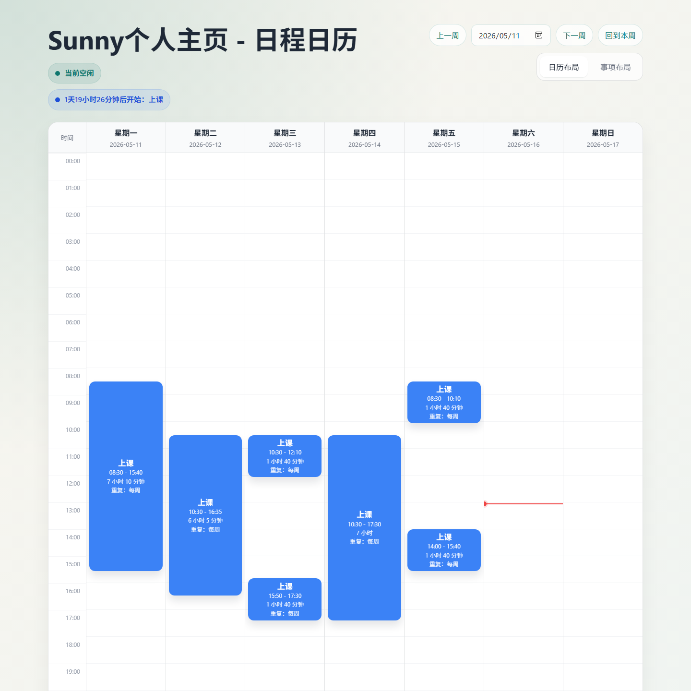

<div align="center">
  
  <h1>日程日历</h1>
  <p>提供前台日历页面、控制台事项管理和编辑器日程卡片的 Halo 插件</p>
</div>

<p align="center">
  
  
  
  
</p>

<p align="center">
  <a href="https://github.com/sunnyhmz7010/halo-plugin-schedule-calendar/releases"></a>
  <a href="https://github.com/sunnyhmz7010/halo-plugin-schedule-calendar/blob/main/LICENSE"></a>
  <a href="https://github.com/sunnyhmz7010/halo-plugin-schedule-calendar/actions/workflows/ci.yml"></a>
</p>

---

## ✨ 为什么做这个插件

Halo 默认并没有提供一套完整的日程日历能力。这个插件的目标，就是给 Halo 直接补上一套可用的日程系统。

- 给站点新增可直接访问的公开日历页面
- 给控制台新增本地事项管理、外部日历订阅、循环规则和备份恢复能力
- 给编辑器新增可插入文章的日程卡片
- 给主题和自定义前端新增可直接读取的 Finder、REST API 与公开 iCal 订阅

## 📸 截图预览

<p align="center">
  
</p>

## 🚀 核心能力

- 公开日历：访问 `/schedule-calendar`，切换周历和事项布局，查看当前状态、下一事项倒计时与当前时间线。
- 本地事项管理：在控制台新增、编辑、删除或停用事项，设置循环规则，也可通过文本批量导入。
- 外部日历订阅：添加可公开读取的 HTTPS iCal/ICS 地址，把外部安排与本地事项合并展示，并可手动刷新。
- 文章日程卡片：在 Halo 默认编辑器中选择本地事项或外部日历事项，插入包含时间、地点、备注和循环摘要的卡片。
- 公开 iCal 订阅：通过 `/schedule-calendar.ics` 在其他日历应用中订阅已启用的本地事项。
- 备份恢复与权限：导出和恢复插件设置、本地事项及外部订阅配置，区分查看权限和管理权限。
- 主题与 API 集成：通过同名主题模板自定义页面，或使用 `scheduleCalendarFinder`、REST API 读取日程数据。
## ⚡ 快速开始

### 📋 前置要求

- Halo `>= 2.25.0`
- JDK `21`

### 📦 安装与运行

1. 从 [Releases](https://github.com/sunnyhmz7010/halo-plugin-schedule-calendar/releases) 下载插件 `jar`
2. 在 Halo 控制台安装插件
3. 启用后访问 `/schedule-calendar`
4. 打开控制台中的"日程日历"开始维护事项

## 📖 使用说明

### 🌍 公开页面

插件启用后即可访问：

```text
/schedule-calendar
```

如果要订阅本地事项的公开 iCal，可使用：

```text
/schedule-calendar.ics
```

该订阅地址仅包含本地事项，不包含外部日历订阅数据。

如果要嵌入单个事项卡片，可使用：

```text
/schedule-calendar/cards/{name}
```

### 🎨 主题适配

主题开发者可以在主题的 `templates/` 目录下放置同名模板文件来自定义公开页面外观：

| 路由 | 主题模板文件 |
|------|-------------|
| `/schedule-calendar` | `templates/schedule-calendar.html` |
| `/schedule-calendar/cards/{name}` | `templates/schedule-calendar-card.html` |

若主题提供了对应模板，Halo 会优先使用主题模板渲染；若未提供，则回退到插件内置模板。模板中可使用的 model 变量：

**`schedule-calendar.html`：**

| 变量 | 类型 | 说明 |
|------|------|------|
| `title` | String | 公开页面标题（来自插件设置） |
| `view` | WeekViewResponse | 周视图数据对象，包含 `days`、`summary`、`weekStart` 等字段 |
| `_templateId` | String | 固定为 `"schedule-calendar"` |

**`schedule-calendar-card.html`：**

| 变量 | 类型 | 说明 |
|------|------|------|
| `title` | String | 事项标题 |
| `color` | String | 事项颜色（如 `#3b82f6`） |
| `summary` | String | 时间或循环摘要 |
| `summaryClass` | String | 摘要 CSS 类名 |
| `nextOccurrenceLabel` | String | 下一次出现标签（可为 null） |
| `sourceLabel` | String | 来源标签（可为 null） |
| `location` | String | 地点（可为 null） |
| `description` | String | 备注（可为 null） |

参考 `plugin-links`、`plugin-moments` 的主题模板覆盖模式。内置模板源码见 `src/main/resources/templates/`。

### 📥 批量导入

在控制台"本地事项"区域，点击"批量导入"按钮，通过文本格式一次性添加多条日程。

**格式说明**：

- 每条以「标题：」开头，字段按行填写，空行分隔不同日程
- 字段名/冒号均支持中英文
- 日期：`2026-07-02`、`2026/07/02`、`2026年7月2日`、`07-02`（补今年）
- 时间：`10:00` 或 `10：00`
- 颜色：`#3b82f6` 或 `3b82f6`，大小写均可
- 说明支持多行，缩进内容自动合并

**示例**：

```text
标题：团队周会
开始：2026-07-02 10:00
结束：2026-07-02 11:00
地点：会议室A
说明：讨论Q3计划
    参与人：张三、李四

标题：项目评审
开始：2026-07-03 14:00
结束：2026-07-03 16:00
颜色：#FF6B6B
```

### 🔎 主题 Finder

主题模板可直接使用以下 Finder：

- `scheduleCalendarFinder.week(start)`
- `scheduleCalendarFinder.summary()`
- `scheduleCalendarFinder.day(date)`
- `scheduleCalendarFinder.range(start, end)`
- `scheduleCalendarFinder.upcoming(limit)`
- `scheduleCalendarFinder.get(name)`
- `scheduleCalendarFinder.listAll()`

示例：

```html
<div th:with="week=${scheduleCalendarFinder.week('2026-04-01')}">
  <div th:text="${week.weekStart}"></div>
  <div th:text="${week.summary.current.text}"></div>
</div>

<div th:each="item : ${scheduleCalendarFinder.upcoming(5)}">
  <span th:text="${item.title}"></span>
  <time th:text="${item.startTime}"></time>
</div>

<div th:with="summary=${scheduleCalendarFinder.summary()}">
  <span th:text="${summary.next.text}"></span>
</div>
```

Finder 适合直接在 Halo 主题中读取：

- 当前周完整周视图
- 当前状态与下一个事项摘要
- 指定日期的时间块
- 指定区间内展开后的事项发生记录
- 单事项卡片或全量事项列表

### 📡 REST API

如果你更习惯在主题外部、独立前端或脚本里消费 JSON，可使用这些公开接口：

```text
GET /apis/api.schedule.calendar.sunny.dev/v1alpha1/weeks?start=2026-04-01
GET /apis/api.schedule.calendar.sunny.dev/v1alpha1/summary
GET /apis/api.schedule.calendar.sunny.dev/v1alpha1/days?date=2026-04-01
GET /apis/api.schedule.calendar.sunny.dev/v1alpha1/occurrences?start=2026-04-01&end=2026-04-07
GET /apis/api.schedule.calendar.sunny.dev/v1alpha1/upcoming?limit=10
GET /apis/api.schedule.calendar.sunny.dev/v1alpha1/entrycards
GET /apis/api.schedule.calendar.sunny.dev/v1alpha1/entrycards/{name}
```

其中：

- `weeks` 返回周视图，并附带 `serverTime`、`zoneId`、`summary`
- `summary` 返回当前状态和下一个事项摘要
- `days` 返回单日占用时间块与空闲时间块
- `occurrences` 返回区间内展开后的实际发生记录
- `upcoming` 返回未来事项
- `entrycards` 返回基础事项卡片数据

## 🧠 功能细节

### 🗓️ 周历体验

- 周视图和事项视图可切换
- 本地事项和外部日历订阅会在同一套周历中展示
- 会根据服务端时间计算当前状态
- 会显示下一个事项距离开始还有多久
- 会在当天列中标出当前时间线

### 📝 事项模型

- 支持标题、时间、地点、说明
- 支持启用/停用状态
- 支持循环频率、循环间隔、截止日期
- 循环事项会在周视图、区间查询和未来事项列表中按真实发生时间展开

### 📦 备份恢复

- 支持导出插件设置、本地事项和外部日历订阅
- 支持恢复时新增、更新、删除本地事项
- 支持恢复时新增、更新、删除外部日历订阅
- 恢复完成后会提示本地事项和外部日历订阅各自的新增、更新、删除数量

### 🔐 权限与维护

- 匿名访客可访问公开页面和公开 API
- 控制台支持查看权限与管理权限区分
- 管理权限可进行本地事项和外部日历订阅的新增、编辑、删除、刷新、备份和恢复

## 🧱 技术栈

- 运行平台：Halo `>= 2.25.0`
- 后端：Java 21、Gradle、Halo Plugin API
- 控制台前端：Vue 3、TypeScript、Vite、Halo UI Components
- 编辑器集成：Halo Rich Text Editor 扩展
- 对外集成：Finder API、REST API、iCal/ICS 订阅
- 构建方式：Gradle 多模块构建，`ui/` 前端产物打包进插件控制台资源

## 🗂️ 项目结构

```
halo-plugin-schedule-calendar/
├─ src/main/java/run/halo/schedule/calendar/  # 插件后端、公开页面、REST API、Finder、查询与备份逻辑
├─ src/main/resources/                        # plugin.yaml、插件资源和 Halo 扩展配置
│  └─ extensions/                             # 权限模板、插件设置 schema 等扩展定义
├─ ui/                                        # 控制台前端与编辑器扩展源码
│  └─ src/
│     ├─ views/                               # 控制台页面
│     ├─ editor/                              # 编辑器日程卡片扩展
│     ├─ utils/                               # 前端工具函数
│     └─ types/                               # TypeScript 类型声明
├─ gradle/                                    # Gradle Wrapper 支持文件
├─ build.gradle                               # 后端依赖、Halo 插件构建和前端资源打包配置
├─ gradle.properties                          # 插件版本等 Gradle 属性
└─ settings.gradle                            # Gradle 多模块设置
```

## 👨‍💻 本地开发

### 🧰 环境

- JDK `21+`
- Node `20+`
- pnpm `9`

### 🔨 构建插件

```bash
./gradlew.bat build
```

构建产物默认输出到：

```text
build/libs
```

### 🎨 前端开发

```bash
cd ui
pnpm install
pnpm build
pnpm test:unit
```

## 🔐 安全报告

如果发现安全问题，请不要公开披露细节。请优先参考仓库中的 [SECURITY.md](./SECURITY.md) 提交安全报告。

## 📄 许可证

本项目基于 [GPL-3.0](./LICENSE) 开源。

<div align="center">
  <sub>Built with ❤️ by Sunny</sub>
</div>
